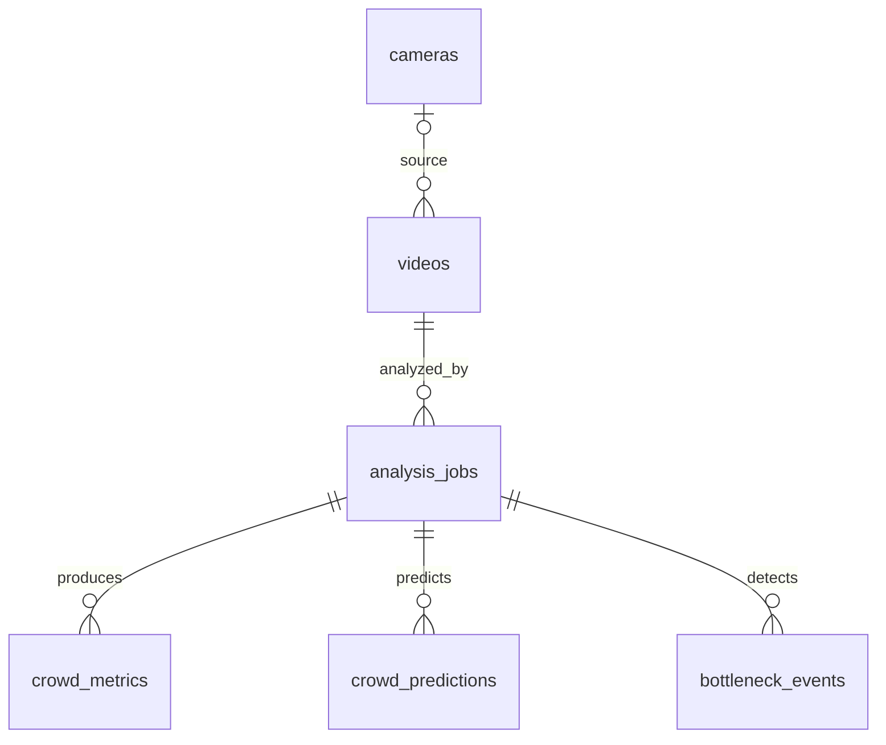

# CROWD PULSE 데이터베이스

추가된 Vision CSV 저장 구조와 API는 [VISION_RESULTS.md](VISION_RESULTS.md)를 참고한다.

PostgreSQL 17.11 / TimescaleDB 2.31.0. 연결은 기존 `app/database.py`의
설정과 `backend/.env`를 사용한다. Alembic 설정 파일에는 자격 증명을 넣지 않는다.
확장은 이미 설치되어 있어야 하며, 이 프로젝트의 마이그레이션은 확장을 설치하거나
서버 설정, 압축, 보존/삭제 정책을 변경하지 않는다.

## 관계와 테이블



| 테이블 | 종류 | 기본키 | 역할 |
|---|---|---|---|
| cameras | 일반 테이블 | id (integer) | 기존 Camera 모델 유지 |
| videos | 일반 테이블 | id (UUID) | 원본·저장 파일명, 상대 저장 경로, 바이트 크기, 영상 메타데이터 |
| analysis_jobs | 일반 테이블 | id (UUID) | 영상별 여러 분석 실행, 상태, 모델 버전, 오류, 실행 시각 |
| crowd_metrics | Hypertable | (id, analyzed_at) | 구역별 인원수·혼잡도·밀도와 영상 위치 |
| crowd_predictions | Hypertable | (id, predicted_at) | 예측 기준·대상 영상 위치, 예상 인원·혼잡도·신뢰도 |
| bottleneck_events | 일반 테이블 | id (UUID) | 구역별 병목 구간, 심각도, 최대 인원, 설명 |

영상 → 작업 → 결과 순서로 외래키를 사용하며 모두 `ON DELETE RESTRICT`이다.
시계열 테이블끼리의 외래키는 없다. `camera_id`는 선택 사항이며 업로드만으로 카메라를
자동 생성하지 않는다. UUID 기본값은 ORM에서 생성한다. 직접 SQL로 넣을 때는 UUID를 제공한다.

## 시간 의미

- 모든 실제 시각은 `TIMESTAMPTZ`이다. API/worker는 시간대가 포함된 datetime을 전달한다.
- `videos.recorded_at`: 실제 첫 프레임 촬영 시각. 알 수 없으면 `NULL`.
- `videos.uploaded_at`: 실제 DB 등록 시각. 촬영 시각으로 사용하지 않는다.
- `analysis_jobs.created_at`, `started_at`, `finished_at`: 작업 생성·실행 시각.
- `crowd_metrics.video_offset_ms`: 영상 시작 이후 밀리초. `analyzed_at`은 실제 분석 시각,
  `captured_at`은 해당 프레임의 실제 촬영 시각이다.
- `crowd_predictions.predicted_at`: 예측 생성 시각. `source_offset_ms`는 예측 기준 영상 위치,
  `target_offset_ms`는 그보다 뒤의 대상 위치. `target_captured_at`은 대상의 실제 촬영 시각이다.
  예측 생성 시각에 horizon을 더해 촬영 시각을 만들지 않는다.
- `bottleneck_events.start_offset_ms`, `end_offset_ms`: 영상 내 구간.
  `detected_at`은 탐지 기록 시각이며 `captured_start_at`, `captured_end_at`은 실제 촬영 시각이다.
- 촬영 시각 컬럼에는 Python/서버 기본값을 두지 않는다. 실제 촬영 시작 시각이 검증된 경우에만
  상대 위치를 더해 프레임/대상 시각을 계산할 수 있다. 파일 수정 시각이나 업로드 시각으로 대체하지 않는다.
- 열린 병목 구간의 종료 위치·종료 촬영 시각은 `NULL`이다. 밀도는 실제 면적이 확인된 경우의
  명/㎡이며, 보정되지 않은 영상은 `NULL`이다.

Hypertable은 촬영 시각을 모르는 업로드 영상도 다루기 위해 각각 NOT NULL인 실제 처리 시각
`analyzed_at` / `predicted_at`으로 분할한다. 이 두 시각은 worker가 명시적으로 제공해야 한다.
기본 청크 간격은 1일이며, 운영 데이터량을 확인한 뒤 별도 마이그레이션으로 조정할 수 있다.
이는 확장/서버 설정 변경이 아니라 새 테이블 생성 시의 분할 정의이다.

모든 고유 제약은 파티션 시간을 포함한다. UUID만으로 전역 유일성을 강제하지 않으므로 ORM의
`Session.get()`에는 `(id, analyzed_at)` 또는 `(id, predicted_at)` 전체 기본키를 전달한다.
작업별 시간 조회와 작업·구역별 영상 위치 조회 인덱스를 제공한다. 시간 범위를 함께 지정하면
청크 제외가 가능하다. 재분석 결과는 새 작업 ID로 분리한다.
이 구성은 [TimescaleDB의 고유 제약 규칙](https://www.tigerdata.com/docs/reference/timescaledb/hypertables/create_hypertable)을 따른다.

인원수·상대 위치·파일 크기는 음수가 될 수 없고, 혼잡도는 0–100, 신뢰도는 0–1이다.
상태 및 종료 시간/구간의 순서도 CHECK 제약으로 검증한다.

## 설치 및 마이그레이션

Python 3.11 이상 권장. 아래 명령은 `backend/`에서 실행한다. PowerShell에서는
`python`을 실제 가상환경의 `python.exe` 경로로 대체할 수 있다.

```powershell
python -m pip install -r requirements-dev.txt
python -m alembic upgrade head
python -m alembic current
python -m alembic check
python -m pytest -q
```

최초 리비전은 `20261112_01`이다. 기존 Camera 모델의 `Base` import 경로도 유지된다.
마이그레이션이 스키마의 유일한 생성 경로이며 앱 시작 시 `create_all()`을 실행하지 않는다.
모델 import와 마이그레이션 실행은 AI 작업이나 예측 데이터를 생성하지 않는다.

마이그레이션은 새 테이블만 생성하고, 동일 이름의 기존 테이블이 있으면 실패하여 트랜잭션 전체가
롤백된다. 기존 테이블을 덮어쓰거나 자동 채택하지 않는다. 충돌 시 기존 구조를 검토한 별도
전진 마이그레이션이 필요하다. 관련 없는 기존 테이블은 autogenerate 비교 대상에서 제외한다.
현재 연결의 기본 `public` 스키마를 사용한다.

데이터 보존을 위해 이 최초 리비전의 파괴적인 `downgrade`는 차단한다. 되돌리기가 필요하면
데이터 보존 방안을 검토한 전진 마이그레이션을 만든다. `stamp`로 버전만 맞추지 않는다.

## 업로드 호환성

`POST /api/videos/upload`의 확장자·200MiB 제한과 기존 201 응답의 여섯 필드는 유지된다.
파일 저장 후 `videos`에 기록하며 UUID 응답은 기존의 하이픈 없는 hex 형식이다.
DB 실패 시 rollback하고 이번 요청으로 생성한 파일을 제거하며, 응답에 DB 세부 오류를 노출하지 않는다.
파일시스템과 DB는 하나의 원자적 트랜잭션이 아니므로 프로세스 강제 종료 시 고아 파일이 남을 수 있다.
추후 정합성 점검 작업으로 다룰 수 있으며 자동 삭제 작업은 추가하지 않았다.

이전 업로드 파일은 변경하거나 자동 등록하지 않는다. 업로드 시각/촬영 시각을 정확히 복원할 수
없으므로 별도 검토 후 가져와야 한다. 대시보드 요약은 기존 mock 응답을 유지한다.

## 검증 범위

테스트는 마이그레이션이 적용된 실제 PostgreSQL/TimescaleDB를 사용한다.
모든 fixture 행은 외부 트랜잭션 안에서 생성하고 종료 시 rollback한다. 업로드 테스트 파일은
pytest 임시 디렉터리를 사용한다. 기존 업로드 경로와 행을 정리/삭제하지 않는다.
`pytest -m 'not integration'`으로 DB 쓰기 없는 메타데이터·오프라인 DDL 검사만 실행할 수 있다.

검증 항목: Hypertable과 분할 컬럼, 복합 기본키, 모르는 촬영 시각의 NULL 유지,
처리 시각과 촬영 시각 분리, CHECK/NOT NULL/FK/중복키 거부, 반복 upgrade의 행 보존,
업로드 DB 기록, 실패 시 파일 정리, 기존 health/대시보드 응답 유지.
